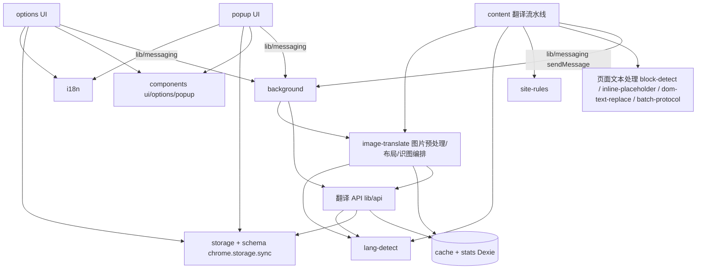

# 代码地图

## 树

```
translator/
├── src/                          # 全部源码（WXT srcDir: 'src'）
│   ├── entrypoints/              # 扩展入口（WXT 自动扫描生成 manifest）
│   │   ├── background.ts         # Service Worker：消息路由、缓存清理 alarm、快捷键、图片右键菜单
│   │   ├── content/              # 内容脚本：页面翻译流水线（段落识别、占位符、观察器、样式、划词/输入框翻译、SPA 检测、图片翻译入口与覆盖层）
│   │   ├── popup/                # popup UI：快速翻译、本地图片翻译、历史记录、页面翻译启停
│   │   └── options/              # 设置页 UI 入口
│   ├── components/
│   │   ├── ui/                   # 基础组件（Button、Select、Textarea、Toast…）
│   │   ├── options/              # 设置页分区组件（提供商、语言、显示、统计、备份…）
│   │   └── popup/                # popup 组件（translation-result）
│   ├── lib/                      # 核心逻辑（翻译 API、缓存、存储、schema、i18n、段落/占位符/DOM 处理）
│   │   ├── api/                  # 模型队列构建、SSE 流式解析、识图请求
│   │   ├── image-translate/      # 图片获取/缩放/哈希/背景采样、布局/对比度、识图解析与翻译编排
│   │   └── site-rules/           # 站点特化规则（如 github）
│   ├── hooks/                    # use-dark-mode、use-toast
│   ├── types/                    # 全局类型定义
│   └── assets/                   # Tailwind 主题变量 + 暗色模式
├── public/_locales/              # i18n 消息文件（zh_CN、en）
├── tests/                        # bun:test 单测
├── scripts/                      # 发版脚本（release.mjs、verify-release.mjs）
└── docs/                         # 隐私政策等静态文档
```

## 模块

| 模块 | 路径 | 职责 | 主要入口 |
| --- | --- | --- | --- |
| background | `src/entrypoints/background.ts` | 消息路由中枢、定时缓存清理、快捷键命令、图片右键菜单注册与点击下发 | `background.ts` |
| content 翻译流水线 | `src/entrypoints/content/` | 页面段落识别、批量翻译调度、显示样式、SPA 检测、划词/悬停/输入框翻译、图片翻译悬浮入口、原位覆盖层/工具条与加载/错误状态 | `index.ts` |
| popup UI | `src/entrypoints/popup/` | 快速翻译、本地图片翻译、历史记录、页面翻译启停（tabs 消息直达 content script） | `main.tsx` |
| options UI | `src/entrypoints/options/` | 设置页全量配置 | `main.tsx` |
| UI 组件 | `src/components/` | 基础组件 + 设置页/popup 分区组件 | `ui/`、`options/`、`popup/` |
| 翻译 API | `src/lib/api.ts` + `src/lib/api/` | LLM 调用、模型队列降级、SSE 解析、翻译缓存读写 | `api.ts` |
| 图片翻译 | `src/lib/image-translate/` | 图片获取/缩放/哈希/背景采样、布局与对比度纯函数、识图提示词/解析、识别缓存与翻译编排 | `pipeline.ts`、`layout.ts` |
| 页面文本处理 | `src/lib/`（block-detect、inline-placeholder、dom-text-replace、batch-protocol） | 段落识别、行内富文本占位符、DOM 文本替换、批量拼接协议 | 各单文件 |
| 站点规则 | `src/lib/site-rules/` | 按站点特化段落/翻译行为 | `index.ts` |
| 配置与存储 | `src/lib/storage.ts` + `src/lib/schema.ts` + `src/lib/crypto.ts` | chrome.storage.sync 读写、Zod 校验、加密导入导出 | `storage.ts` |
| 缓存与统计 | `src/lib/cache.ts` + `src/lib/stats.ts` | IndexedDB 翻译缓存、图片识别缓存、请求日志与 token 用量 | `cache.ts` |
| i18n | `src/lib/i18n.ts` + `public/_locales/` | 运行时 UI 语言切换、消息加载 | `i18n.ts` |
| 语言检测 | `src/lib/lang-detect.ts` | franc / API 语言检测、翻译调度目标语言跳过判定 | `lang-detect.ts` |
| hooks | `src/hooks/` | 暗色模式、toast | — |
| 发版脚本 | `scripts/` | 版本 bump、tag、push、Release 校验 | `release.mjs` |

## 依赖



## 关键路径

- **页面翻译**：content `index.ts` 段落识别（block-detect + site-rules）→ Intersection Observer（observer.ts）收集可视段落 → 目标语言跳过判定（lang-detect，已是目标语言的段落标记跳过）→ batch-protocol 批量拼接 → messaging 发给 background → `lib/api` 查缓存 / 按模型队列调用 LLM（SSE 流式）→ 译文回 content → inline-placeholder 还原 + dom-text-replace 写回 DOM + style-apply 应用四种显示样式；批量失败回落逐段翻译
- **popup 快译**：popup `main.tsx` → sendMessage → background → `lib/api.translate()` → 展示结果
- **配置生效**：options 修改 → `storage.ts`（Zod 校验）→ chrome.storage.sync → background / content 下次读取生效
- **图片翻译**：网页图片右键菜单经 background 向图片所在 frame 发 `TRANSLATE_IMAGE`，由 content 定位并触发；content / popup 发 `IMAGE_TRANSLATE`（http(s) 图片 + pageUrl，或 data URL）→ background `image-translate/pipeline` 先查视觉模型队列（无模型不拉图）→ 取图 / SHA-256 / 识别缓存 → 缩放识图并采样背景色 → 逐块复用 `lib/api.translate()` → 返回归一化块与译文；覆盖层用 `layout` helper 定位与选对比色
